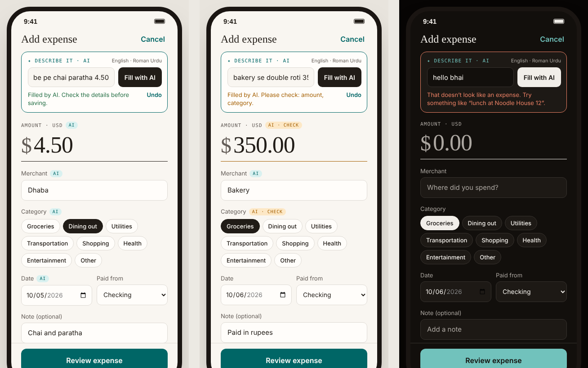

<div align="center">

# Three Apps, Three Identities

**Interactive, high-fidelity mobile prototypes for food delivery, fitness and budgeting**

Designed and built by **Muhammad Mohtashim** · UI/UX Designer · AI-assisted design workflow

✦ **New:** Pocket now has an AI feature. Describe an expense in plain English or Roman Urdu and AI fills the form.

[**▶ Live demo**](https://muhmmadf-stack.github.io/3-Apps-Wireframes-Templates/Index.dc.html) · [AI feature](#-ai-feature-describe-an-expense-in-your-own-words) · [Figma file](#) · [Case study](#case-study)

<!-- Add a hero image or GIF here: three phone screens side by side -->
<!--  -->

</div>

---

## At a glance

| | App | Category | What you can do in it |
|---|---|---|---|
| 🍜 | **Daily Dish** | Food delivery | Discover restaurants, customize dishes, apply promo codes, check out and track the order live |
| 🏃 | **Stride** | Fitness | Hit a weekly goal, find workouts, run a real interval timer, review progress |
| 💰 | **Pocket** | Budgeting | **✦ Add expenses by describing them in plain words (AI)**, see what's left this month, search transactions, edit budgets |

All three are **clickable end to end**. These aren't static mockups; every screen, flow and state actually works. No install needed: open a file in the browser and use it like a real app.

---

## ✦ AI feature: describe an expense in your own words

In **Pocket**, you don't have to fill the expense form field by field. Type it the way you'd text a friend, in English, Roman Urdu or a mix, and AI fills the form for you:

| You type | AI fills in (example) |
|---|---|
| `kal dhabe pe chai paratha 4.50` | **$4.50** · Dhaba · Dining out · *yesterday* · note "Chai and paratha" |
| `uber to uni 6 on card` | **$6.00** · Uber · Transportation · today · Credit card |
| `electricity bill 112` | **$112.00** · Electricity · Utilities · today |



### How it works

```
Pocket app (browser)                 Our server                       Google Gemini
──────────────────                   ──────────                       ─────────────
"kal dhabe pe chai 4.50"  ──POST──▶  /api/parse-expense   ──────────▶  model returns JSON
                                     • checks the input               that must match a
form fields filled  ◀──── JSON ────  • adds the secret API key        fixed schema
(with "AI" tags)                     • validates every field  ◀──────
```

- The **API key stays on the server** (`api/parse-expense.js` on Vercel, or `server.mjs` locally). It is never in the browser or in this repo.
- Gemini is asked for **structured JSON output** with a fixed schema: amount, merchant, category (only the app's 8 categories), date, account, note, and a list of fields it was **unsure** about.
- The server **never trusts the AI blindly** (`lib/parseExpense.js`). A negative amount, an invented category or a future date is replaced with a safe value and flagged for the user to check.
- Input is capped at 300 characters, requests time out after 12 seconds, and there is a basic per-IP rate limit.

### UX decisions for the AI

Designing *around* the AI mattered more than the API call itself:

- **AI suggests, the user decides.** AI only fills the form; nothing is saved until the user taps *Review expense*. Every field stays editable.
- **Show what the AI did.** Fields filled by AI get a small `AI` tag. Fields it guessed get an amber `AI · CHECK` tag and are listed in plain words ("Please check: amount, category").
- **Easy to reverse.** One tap on *Undo* restores the form exactly as it was.
- **Edits are respected.** When you change a field yourself, its AI tag disappears, because it's your value now.
- **Honest errors.** Messages say what happened and what to do next: not an expense, AI busy (free-tier limit), no connection, or AI not set up on this host.
- **The old way still works.** The manual form is untouched, so the app is fully usable even if the AI is down.

### Run the AI feature

You need a free Gemini API key from [Google AI Studio](https://aistudio.google.com/apikey) and Node.js 18+.

**Locally**
```bash
cp .env.example .env        # Windows: copy .env.example .env
# open .env and paste your key after GEMINI_API_KEY=
node server.mjs             # then open http://localhost:3000
```

**Live on Vercel** (GitHub Pages can't run servers, so the AI part needs Vercel)
1. Go to [vercel.com/new](https://vercel.com/new) and import this repository (no build settings needed)
2. In **Settings → Environment Variables**, add `GEMINI_API_KEY` with your key
3. Deploy, then open `/Pocket.dc.html` on your Vercel URL

**Tests:** `npm test` runs 6 tests for the server logic with a mocked Gemini, so no key is needed.

> On GitHub Pages or when opening the file directly, Pocket still works. *Fill with AI* just shows a message that AI isn't available on that host.

---

## Case study

### The challenge
I wanted to prove one thing: **a single designer can give three products in completely different categories their own personality**, while still following the same usability rules underneath.

So each app had to:
- Feel like its own brand (typeface, colour, tone), not three recolours of one template
- Cover a **complete user journey**, not just the happy-path home screen
- Handle the boring-but-important states: empty, error, validation and confirmation
- Be testable on a real phone, so stakeholders and test users can click through instead of imagining it

### My process

```
Research & references  →  User flows  →  Wireframes  →  Visual identity per app  →  Interactive prototype  →  Edge states & polish
```

1. **Mapped the core journeys first:** order → track (Daily Dish), plan → train → review (Stride), log → review → save (Pocket)
2. **Wireframed** each flow at 390 × 844 (iPhone frame) with 44 pt minimum touch targets
3. **Gave each app its own identity** (see table below)
4. **Built the prototypes** as working HTML so the interactions could be tested, not just described
5. **Designed the "unhappy paths":** wrong promo code, empty cart, no search results, over-budget categories, ending a workout early

### Visual identity: one designer, three personalities

| App | Mood | Typography | Accent |
|---|---|---|---|
| Daily Dish | Warm, appetizing, friendly | Bricolage Grotesque + Figtree | Tomato red-orange |
| Stride | Loud, energetic, sporty | Archivo (extra-wide, uppercase) | Electric lime |
| Pocket | Calm, editorial, trustworthy | Newsreader (serif) + IBM Plex Sans | Deep teal |

Every app also has a full **light and dark mode**, built on CSS variables (`--accent`, `--bg`, `--ink`) so the whole theme switches from one place.

### Key UX decisions

- **Daily Dish: one restaurant per cart.** Adding from a second restaurant shows a confirmation instead of silently clearing the cart, so the user never loses an order by accident.
- **Daily Dish: live price on customization.** Required vs. optional modifiers, selection limits and the total update as you choose, so there's no surprise at checkout.
- **Stride: a real timer, not a fake screen.** Work/rest phases, a progress ring, pause/resume, skip, and optional beeps. Ending early lets you *save the partial session or discard it*, because real workouts get interrupted.
- **Pocket: review before saving.** Before an expense is saved, you see what it does to that category's budget. Money apps should show consequences *before* commit, not after.
- **Pocket: data that adds up.** Totals, budgets and progress are calculated from the transactions, not hard-coded, so deleting an expense updates everything instantly.

---

## Features

<details>
<summary><b>🍜 Daily Dish: food delivery</b></summary>

- Restaurant discovery with live search across restaurants **and** dishes
- Cuisine filters, sorting (top rated, fastest, lowest fee), delivery-time and fee filters
- Favorites from any screen + dedicated Favorites tab
- Restaurant menu with section navigation and in-menu search
- Item customization: required/optional modifier groups, limits, special instructions, quantity, live price
- Cart & checkout: edit/remove lines, standard vs. priority delivery, editable address, payment method
- Promo codes with validation and error states:
  - `DISH10`: 10% off
  - `FREEDEL`: free delivery
  - `WELCOME5`: $5 off orders of $15+
- Live order tracking: Confirmed → Preparing → On the way → Delivered (cancel available before pickup)
- Order history with one-tap reorder
</details>

<details>
<summary><b>🏃 Stride: fitness tracking</b></summary>

- Daily dashboard: weekly goal progress, minutes, calories, 7-day activity chart, recommended workout
- Workout search by name or exercise; filters for type (Strength, Cardio, Mobility, Saved), duration and level
- Workout detail: warm-up / rounds / cool-down structure and full move list; save for later
- Active workout: interval timer, progress ring, segmented session bar, pause/resume, skip, audio cues
- End early: save partial session or discard
- Summary: minutes, calories, average heart rate, goal progress, effort rating
- Progress: weekly minutes chart + full workout history
- Profile: adjustable weekly goal, sound and appearance settings
</details>

<details>
<summary><b>💰 Pocket: personal budgeting</b></summary>

- Overview: remaining monthly budget, spending progress, income, top categories
- Transactions grouped by day, searchable by merchant, category or note; All / Expenses / Income views
- Transaction detail with delete confirmation; budgets recalculate instantly
- **✦ AI input:** describe the expense in your own words and the form fills itself, with AI tags, "please check" hints and Undo
- Add expense: validated amount and merchant, category picker, date, account, note, live budget impact preview
- Review step → saved confirmation with reference number and updated balances
- Budgets: 8 categories, over-budget and near-limit warnings, editable monthly limits
- Month switcher (September / October 2026 sample data)
</details>

---

## 🤖 How I used AI in this project

AI shows up in two places: **inside the product** (the Pocket AI input above) and **in my workflow** (below).

I use AI as part of my design workflow, the way a designer uses Figma plugins. It speeds up the work, but the decisions are mine.

| Stage | My role | AI's role |
|---|---|---|
| Flows & structure | Defined journeys, screens and edge cases | Helped stress-test flows for missing states |
| Visual identity | Chose mood, type pairings and colour direction | Generated variations to compare against |
| Prototype build | Specified behaviour and reviewed every screen | Assisted with writing and debugging the HTML/JS |
| Content | Directed tone per brand | Drafted realistic sample data (menus, workouts, transactions) |

**Why mention it?** Because that's how modern product teams actually work. The skill isn't avoiding AI; it's knowing what to ask for, judging the output, and shipping something that holds up.

---

## Run it locally

```bash
git clone https://github.com/MuhmmadF-Stack/3-Apps-Wireframes-Templates.git
cd 3-Apps-Wireframes-Templates
node server.mjs                  # includes the AI feature (see above for the key)
```

Open **http://localhost:3000**.

No Node.js? Any static server works too, just without the AI feature: `python3 -m http.server 8000` (on Windows: `python -m http.server 8000`), then open `http://localhost:8000/Index.dc.html`. You can also double-click `Index.dc.html`.

> An internet connection is needed: React and the fonts load from a CDN. Keep `support.js` in the same folder as the `.dc.html` files.

### Publish on GitHub Pages (without AI)
1. **Settings → Pages → Deploy from a branch** → `main` / `(root)` → Save
2. Live at `https://muhmmadf-stack.github.io/3-Apps-Wireframes-Templates/`

For the AI feature to work online, deploy on Vercel instead (steps in the AI section above).

---

## Project structure

```
├── index.html               # Redirects to Index.dc.html
├── Index.dc.html            # Landing page linking all three apps
├── Daily Dish.dc.html       # Food delivery prototype
├── Stride.dc.html           # Fitness prototype
├── Pocket.dc.html           # Budgeting prototype (+ AI expense input)
├── support.js               # Small runtime the prototypes load (uses React from a CDN)
├── api/parse-expense.js     # Vercel serverless function for the AI feature
├── lib/parseExpense.js      # AI logic: prompt, JSON schema, validation (server-side only)
├── server.mjs               # Local dev server (static files + AI endpoint, no installs)
├── tests/                   # npm test: server logic tests with mocked Gemini
├── .env.example             # Copy to .env and add GEMINI_API_KEY
└── LICENSE
```

Each app file has three parts: **markup** (screens), **logic** (a `Component` class holding state and sample data) and **theme** (CSS variables at the top).

**Quick customizations**
- Brand colour → `--accent` in the `<style>` block
- Sample data → `this.R` (restaurants), `this.W` (workouts), `seed()` (transactions)
- Promo codes → `this.PROMOS` in `Daily Dish.dc.html`
- Budget categories → `this.CATS` in `Pocket.dc.html`

---

## What I learned

- **Edge states take longer than the main screens,** and they're what make a prototype feel real.
- **Personality comes from type first, colour second.** Swapping the typeface changed each app's feel more than any colour did.
- **Clickable beats static.** A working prototype gets far better feedback than a set of screenshots.
- **With AI features, trust is the design problem.** Calling the API was quick. Deciding how to show what the AI did, what it guessed, and how to undo it took most of the time.
- **Never put an API key in front-end code.** Anything in the browser is public, so the key lives on a small server function.

### Next steps
- [ ] Usability-test the Pocket AI input: how often do users need to fix what the AI filled?
- [ ] AI monthly summary in Pocket ("You spent 20% more on dining out than planned")
- [ ] Run a 5-user usability test on the Daily Dish checkout flow and document findings
- [ ] Replace image placeholders with real photography
- [ ] Rebuild the design system as a Figma component library

---

## Notes
- Prototypes only: no real payments, accounts or location tracking. Data lives in memory and resets on reload. The only server part is the AI endpoint, which stores nothing.
- Works in recent Chrome, Edge, Safari and Firefox (uses `oklch()` colours and `conic-gradient()`).
- Fonts: Google Fonts (Bricolage Grotesque, Figtree, Archivo, Newsreader, IBM Plex Sans/Mono, JetBrains Mono).

---

<div align="center">

**Muhammad Mohtashim**: UI/UX Designer · BSCS student, Iqra University

Open to UI/UX and AI-workflow roles · [LinkedIn](#) · [Portfolio](#) · [Email](mailto:mohtashim.20445@gmail.com)

Released under the [MIT License](LICENSE).

</div>
